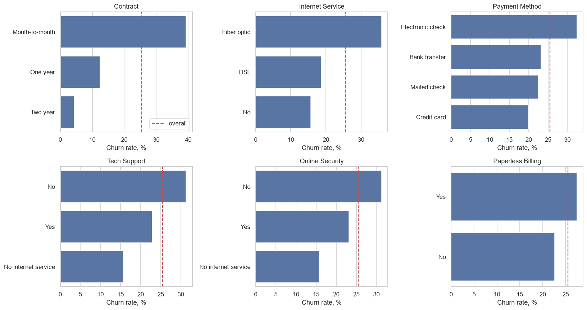
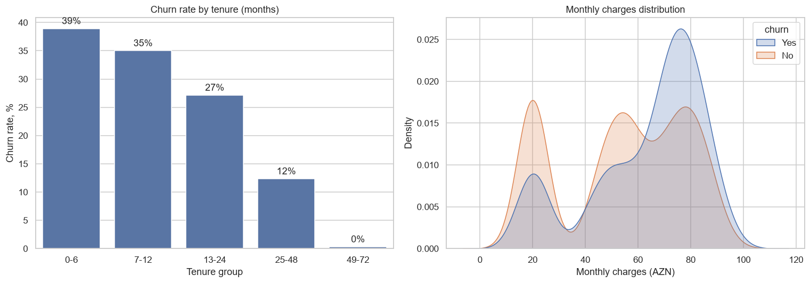
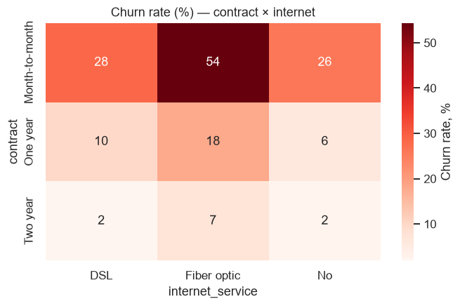
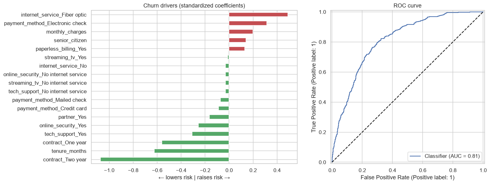

# 📉 Customer Churn Analysis — Telecom

> **Daily Data Analytics Project · Day 01**

Who leaves, why they leave, and which customers a telecom company should target with retention offers.

## 🎯 Business question
The company loses **25.5%** of its customers — about **113K AZN in monthly revenue (28.5%)**. Which factors drive churn, and where should the retention budget go?

## 📊 Key results

| KPI | Value |
|---|---|
| Customers analysed | 7,000 |
| Churn rate | **25.5%** |
| Monthly revenue lost | **113,024 AZN (28.5%)** |
| Avg tenure — churned vs retained | 13.6 vs 21.8 months |
| Model ROC-AUC (logistic regression) | **0.81** |

**Churn by contract type:** Month-to-month **39.3%** · One year 12.4% · Two year **4.3%**
**Churn by tenure:** 0–6 months **38.9%** → 49–72 months **0.3%**
**Electronic check payers:** 32.5% vs 19.9% for credit card






## 🎯 Risk segmentation

| Segment | Customers | Actual churn | Monthly revenue (AZN) |
|---|---|---|---|
| Low | 2,705 | 4.8% | 139,615 |
| Medium | 2,048 | 22.7% | 105,972 |
| **High** | **2,247** | **52.9%** | **150,855** |

The **High** segment holds the largest share of revenue *and* churns at more than twice the average — it is where retention spend pays off most.

## 💡 Recommendations
1. **Contract migration** — discount for switching from month-to-month to a 1-/2-year contract.
2. **Onboarding programme** — the first 6 months are the riskiest; add a welcome call and a first-month check-in.
3. **Bundle tech support** — fiber customers without tech support/security churn most; offer it free for 3 months.
4. **Auto-pay incentive** — move electronic-check payers to card / bank transfer.
5. **Targeted retention** — use the model's risk score to focus offers on the High segment.

## 🛠 Tech stack
Python · pandas · NumPy · matplotlib · seaborn · scikit-learn · Jupyter

## 📁 Structure
```
├── churn_analysis.ipynb   # full analysis (EDA → model → recommendations)
├── data/
│   ├── generate_data.py   # reproducible synthetic dataset generator
│   └── telco_churn.csv    # 7,000 customers, 14 columns
├── images/                # exported charts
└── requirements.txt
```

## ▶️ Run it
```bash
pip install -r requirements.txt
python data/generate_data.py   # optional: regenerate the dataset
jupyter notebook churn_analysis.ipynb
```

> ℹ️ The dataset is **synthetic** (generated with a fixed seed), modelled on patterns typical of telecom churn studies. No real customer data is used.

---

### 🇦🇿 Azərbaycanca xülasə
Telekom şirkətinin müştəri axını (churn) analizi. Müştərilərin **25.5%-i** gedir və bu, aylıq gəlirin **28.5%-i** deməkdir. Ən böyük risk faktorları: aylıq (month-to-month) müqavilə, ilk 6 ay, fiber internetdə texniki dəstəyin olmaması və elektron çeklə ödəniş. Logistic regression modeli (ROC-AUC 0.81) müştəriləri risk seqmentlərinə bölür; **yüksək risk** seqmentində churn 52.9%-dir və saxlama büdcəsi ilk növbədə bura yönəldilməlidir.
